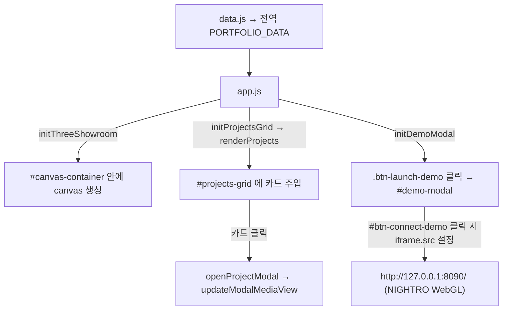

# 🏎️ 3D Virtual Showroom & Game Developer Portfolio
> **Creator:** 박경민 (PARK GYEONG MIN)  
> **Contact:** [parkkm1110@gmail.com](mailto:parkkm1110@gmail.com) | [GitHub](https://github.com/parkkm1110-creator) | [ArtStation](https://krissv9mm1.artstation.com)  
> **Role & Focus:** 3D Technical Artist & Game Developer (1인 풀사이클 제작)  
> **Core Theme:** **`3D ART + ENGINE + AI AGENT`**

---

## 📖 1. 프로젝트 개요 (Overview)

Maya 하드서페이스 모델링, Substance Painter 2K PBR 텍스처링, Unity 6 레이싱 게임, 그리고 AI 에이전트(Google Antigravity + Codex 6.1 Sol + Gemini 3.8 Flash)를 결합해 1인으로 제작한 작업물을 보여주는 포트폴리오 웹사이트입니다. 한 페이지에 세 가지가 들어 있습니다.

1. **Three.js 3D 가상 쇼룸**: 10종 차량을 브라우저에서 회전하고, 조명·페인트·머티리얼을 조절합니다.
2. **`NIGHTRO : Drag Racing` 라이브 데모**: Unity 6 WebGL 빌드를 모달의 iframe으로 띄웁니다. 빌드는 별도 로컬 서버(8090)에서 돌아갑니다.
3. **프로젝트 쇼케이스**: 인게임 스크린샷과 AI 작업 세션 캡처를 증거 자료로 담은 카드 5개입니다.

---

## 🛠️ 2. 기술 스택 (Tech Stack)

### 제작 파이프라인 (사이트가 보여주는 내용)
- **3D:** Maya (SubD 모델링, 로우폴 리토폴로지, UV), ZBrush (보조 블록아웃)
- **텍스처:** Substance 3D Painter (2K PBR)
- **엔진:** Unity 6 (6000.3.23f1) + URP 17.3, C# 종방향 차량 동역학, GREE WebView 기반 HTML HUD
- **AI:** Google Antigravity(에이전트 IDE) · Codex 6.1 Sol(정밀 물리·그래픽스 설계) · Gemini 3.8 Flash(대량 구현) · Meshy AI · Google Stitch · Google Labs

### 웹 프론트엔드 (빌드 단계 없음)
- **일반 `<script>` 태그 + 전역 변수 방식입니다. ES Module이 아닙니다.** `data.js`가 전역 `PORTFOLIO_DATA`를 만들고 `app.js`가 이를 읽습니다. `import`/`export`를 넣으면 깨집니다.
- **스타일:** Tailwind **CDN**(`cdn.tailwindcss.com`, 인라인 `tailwind.config`) + `style.css`(에디토리얼 레이아웃, 마키, 필름 그레인, 스크롤 리빌). 커스텀 색상은 `index.html` 상단 `tailwind.config`에 있습니다.
- **폰트:** Google Fonts CDN (`Barlow Condensed` = `font-display`, `Space Grotesk` = `font-sans`, `JetBrains Mono` = `font-mono`, `Noto Sans KR` = 한글 폴백)
- **3D:** `libs/`의 Three.js(전역 `THREE`), OrbitControls, GLTFLoader, FBXLoader, fflate
- **후처리:** EffectComposer, RenderPass, ShaderPass, UnrealBloomPass (CopyShader, LuminosityHighPassShader 포함)
- **기타:** Lucide 아이콘(`lucide.createIcons()`), GSAP, Web Audio API 엔진음 신시사이저
- ⚠️ Tailwind와 폰트는 CDN이라 **인터넷이 연결돼야 스타일이 정상 적용됩니다.** `libs/`만으로 완전 오프라인은 아닙니다.

---

## 📁 3. 디렉토리 구조 (Directory Map)

```text
portfolio-PROTO/
├── index.html              # 전체 마크업 + tailwind.config(색상) + file:// 접속 차단 안내 오버레이
├── app.js                  # 약 2600줄. 쇼룸 3D 엔진·머티리얼 인스펙터·프로젝트 카드/모달·데모 모달 전부
├── data.js                 # PORTFOLIO_DATA: creator(프로필)와 projects(5개)만 있음
├── style.css               # 보조 스타일 (작은 파일, 대부분의 스타일은 Tailwind 클래스)
├── server.cjs              # 정적 서버 (127.0.0.1:8080, CORS 허용, 시작 시 브라우저 자동 오픈)
├── START_PORTFOLIO.cmd     # server.cjs 실행 + 브라우저 오픈
├── assets/
│   ├── icons/              # 도구 브랜드 아이콘 + nightro_logo.png
│   ├── models/             # 차량 FBX/GLB/텍스처 (쇼룸이 로드)
│   ├── screenshots/        # 렌더샷 + 인게임/AI 증거 스크린샷
│   └── projects/<id>/      # 모달 4-View 전용 이미지 (hero/wireframe/texture/detail.png)
└── libs/                   # Three.js, 로더, 후처리, GSAP, Lucide (로컬 사본)
```

> **차량 10종 정보는 `data.js`가 아니라 `app.js`에 있습니다.** `FLEET_TITLES`, `cachedFleetManifest`, `loadFleetVehicle()`, `loadLamboModel()`, `loadBentleyModel()`, `initVehicleSelector()`를 보세요.

---

## ⚙️ 4. 데이터 흐름 (Architecture)



`app.js` 주요 함수 (실제 이름):
- 쇼룸: `initThreeShowroom`, `setupShowroomLighting`, `updateLightingMode`, `createShowroomFloor`, `initShowroomControls`, `animate`
- 차량: `initVehicleSelector`, `loadFleetVehicle`, `initCustomModelLoader`(드래그&드롭 GLB)
- 재질: `initMaterialInspector`, `renderMaterialInspector`, `createFlopMetallicMaterial`, `initFlopShaderControls`
- 오디오: `initAudioSynthesizer`, `startEngineAudio`, `stopEngineAudio`
- 프로젝트: `initProjectsGrid`, `renderProjects(filter)`, `initProjectModal`, `openProjectModal`, `updateModalMediaView`
- 데모: `initDemoModal`

**프로젝트 카드 렌더링 규칙** (`data.js` 필드 → 카드):
- `thumbnail`: 카드 이미지. `thumbnailFit: "contain"`이면 `object-contain`으로 그리고 검은 배경을 씁니다. NIGHTRO 로고 때문에 추가했습니다.
- `logo` / `badge`: 있으면 모달 제목 옆에 로고, 카드 우하단에 뱃지(`FULLY PLAYABLE GAME`)를 표시합니다.
- 모달의 4-View는 `assets/projects/<project.id>/<hero|wireframe|texture|detail>.png`를 찾고, 파일이 없으면 `thumbnail`로 대체합니다.

---

## 🏆 5. 프로젝트 5개 (`data.js`)

| `id` | 타이틀 | 썸네일 | 비고 |
|---|---|---|---|
| `race-drag-unity` | NIGHTRO : Drag Racing | `assets/icons/nightro_logo.png` (contain) | 로고가 메인 이미지. 렌더샷은 쇼룸 쪽에서 보여주므로 의도적으로 뺐음 |
| `ai-generative-pipeline` | 생성형 AI 에이전트(Antigravity + Codex + Gemini) | `screenshots/antigravity_agent_session.png` | 안티그래피티 실제 작업 캡처 |
| `unity-flop-paint-lab` | Unity Flop Paint Lab & 2-Tone R&D | `screenshots/ingame_paintkit_lab.jpg` | **랩스(R&D) 프로토타입**이며 완성 기능이 아님 |
| `stitch-gree-webview-ui` | 인게임 레이스 HUD & 튜토리얼 UI | `screenshots/ingame_tutorial_xr500.jpg` | 차고 UI 아님. 레이스 HUD 중심 |
| `racing-fleet-master` | 10-Vehicle Master Fleet | `screenshots/RenderShot_20261019_021048_2x.png` | 차량 3D 아트 쇼케이스 |

---

## ⚠️ 6. 건드리면 안 되는 것 (Claude 인계 규칙)

`app.js`는 **약 70개의 DOM ID를 `getElementById`로 직접 잡습니다.** 하나라도 지우거나 이름을 바꾸면 해당 기능이 조용히 죽습니다. 정확한 목록은 아래 명령으로 뽑을 수 있습니다.

```powershell
Select-String app.js -Pattern "getElementById\('([^']+)'\)" -AllMatches | % { $_.Matches | % { $_.Groups[1].Value } } | Sort -Unique
```

그룹별 핵심 ID:
- **3D 뷰포트:** `#canvas-container` (※ `#webgl-canvas`는 존재하지 않습니다), `#showroom-loader`/`#showroom-loader-text` (JS가 동적 생성)
- **쇼룸 컨트롤:** `#vehicle-select`, `#toggle-autorotate`, `#toggle-wireframe`, `#toggle-lights`, `#toggle-flop`, `#exposure-slider`, `#model-file-input`, `#btn-audio-toggle`
- **머티리얼 인스펙터:** `#mat-inspector-*`, `#btn-toggle-mat-inspector`, `#metalness-*`, `#roughness-*`, `#clearcoat-*`, `#btn-copy-mat-json`, `#btn-reset-mat-settings`
- **Flop 페인트:** `#flop-*` (슬라이더·피커·프리셋·디버그 패널), `#btn-dev-toggle`, `#btn-save-custom-preset`, `#custom-preset-input`
- **프로젝트:** `#projects-grid`, `#project-modal`, `#modal-category|title|desc|media|highlights|tools|specs|file-hint|close-btn`
- **4-View 탭:** `.modal-tab-btn[data-view="hero|wireframe|texture|detail"]`
- **데모 모달:** `#demo-modal`, `#demo-iframe`, `#demo-close-btn`, `#btn-connect-demo`, `#demo-guide-overlay`, 열기 버튼은 **클래스** `.btn-launch-demo` (2곳)

또한 `#projects-grid`에 카드는 **JS가 주입**합니다. `index.html`에 카드 마크업을 직접 쓰지 마세요. 카드 디자인을 바꾸려면 `app.js`의 `renderProjects()` 템플릿 문자열을 수정해야 합니다.

---

## 🎨 7. 디자인 시스템 (Editorial + Subtle Underground)

**실제 색상 토큰** (`index.html`의 `tailwind.config`, `app.js` 하위 호환을 위해 `showroom-*` 토큰명은 그대로 유지):

| 토큰 | 값 | 용도 |
|---|---|---|
| `showroom-950` | `#09090a` | 가장 어두운 배경 (뉴트럴 옵시디언) |
| `showroom-900` | `#0e0e10` | 섹션/카드/모달 배경 |
| `showroom-850` | `#131315` | 카드 호버/서브 패널 배경 |
| `showroom-800` / `700` | `#1a1a1d` / `#27272b` | 버튼·보더 |
| `showroom-gold` / `neon` | `#c6ff32` | 단일 시그널 라임 포인트 (`NIGHTRO` 인게임 HUD 톤과 통일) |
| `showroom-crimson` | `#ff3b30` | 경고/강조 |

- **레이아웃 & 무드:** Awwwards SOTD / 에디토리얼 스튜디오 그리드(`1px` 헤어라인 보더, `2px~4px` 샤프 코너, `word-break: keep-all` 한글 조판)를 메인으로 잡고, 언더그라운드 스트리트 레이싱 감성은 고정 SVG 필름 그레인(`.grain`), 시그널 라임(`#c6ff32`) 단일 포인트, 모노스페이스 텔레메트리 인덱스(`[ 01 ]`), 하단 무한 마키(`.marquee-track`)로 절제해 녹였습니다.
- **프로젝트 그리드 (`1 + 2 + 2`):** `featured: true`인 `NIGHTRO : Drag Racing`(`race-drag-unity`)이 상단 전체 폭(`md:col-span-2 lg:flex-row`) 플래그십 카드로 배치되고, 나머지 4개 프로젝트가 2열 대칭 그리드로 정렬됩니다.

---

## 🚀 8. 실행 방법

**포트폴리오:** `START_PORTFOLIO.cmd` 더블클릭 → `http://127.0.0.1:8080/`. `index.html`을 직접 열면(`file://`) CORS 때문에 3D 모델이 안 읽혀 안내 오버레이가 뜹니다.

**NIGHTRO 라이브 데모:** `B:\BUILD File\RaceDrag_Demo_20261021_Ready\START_DEMO.cmd`를 먼저 실행(8090 포트) → 포트폴리오의 데모 버튼(`.btn-launch-demo`) → 모달에서 **[게임 화면 연결]**. 8090이 이미 사용 중이면 같은 폴더의 `STOP_DEMO.cmd`를 먼저 실행하세요.

---

## 🧾 9. 알려진 한계 & 확인 필요 항목

- **튜토리얼 회색 화면:** 프롤로그 컷씬(`pre.html`)에서 레이스 HUD(`race.html`)로 넘어갈 때 WebView를 `LoadURL`로 다시 로드하면서 생기는 Unity 쪽 문제이고, 포트폴리오 코드와는 무관합니다. 포트폴리오 모달(중첩 iframe)에서는 더 길어질 수 있습니다. 시연 시 SKIP(`S`키)이 안전하며, 새 창으로 열기(`127.0.0.1:8090`)도 방법입니다.
- **모달 탭 라벨은 차량 아트 기준 고정 문구입니다** ("① Hero Render / ② Wireframe & Topology / ③ 4K PBR Breakdown / ④ Close-up Detail"). NIGHTRO는 이 슬롯에 인게임 스샷을 넣어 의미가 어긋나므로, 프로젝트별 탭 라벨 지원이 필요합니다. (`updateModalMediaView`의 `viewLabels`와 `index.html` 탭 버튼)
- **`race-drag-unity` 4-View 파일 확장자:** `wireframe.png`/`texture.png`는 실제로는 JPG 데이터입니다. 브라우저는 표시하지만 정리가 필요합니다. `hero.jpg`, `logo.png`, `gta-spano-supercar/paintkit_lab.jpg`는 쓰이지 않는 잔여 파일입니다.
- **사실 확인이 필요한 문구** (제가 작성한 부분이 포함돼 있습니다. 제출 전에 박경민 님이 확인해야 합니다):
  - "7단 패들 시프트/변속": `data.js:42`, `index.html:983`. 차량마다 기어 수가 달라 근거가 없습니다.
  - "PC Standalone & WebGL": `data.js:51`. 제가 확인한 빌드는 WebGL뿐입니다.
  - "Maya 2024": `index.html:607`. 버전 표기의 근거를 확인하지 못했습니다.
  - "14명 AI 드라이버 / 14단계 캠페인"은 기존 문구를 유지했으며 따로 검증하지 않았습니다.
- Three.js 버전은 확인하지 못했습니다(전역 `THREE` 사용).
